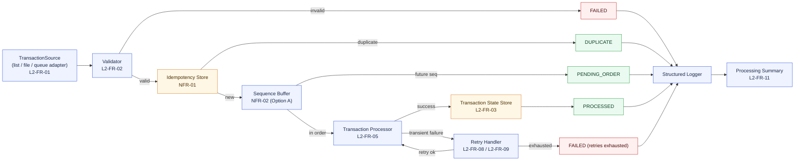
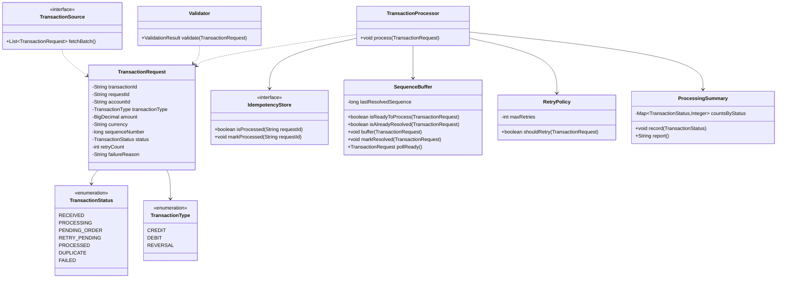
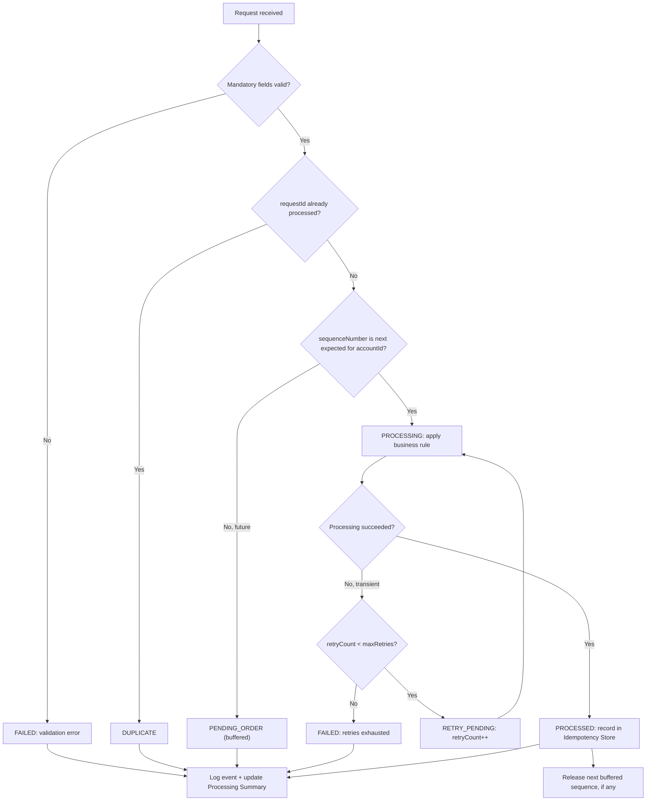
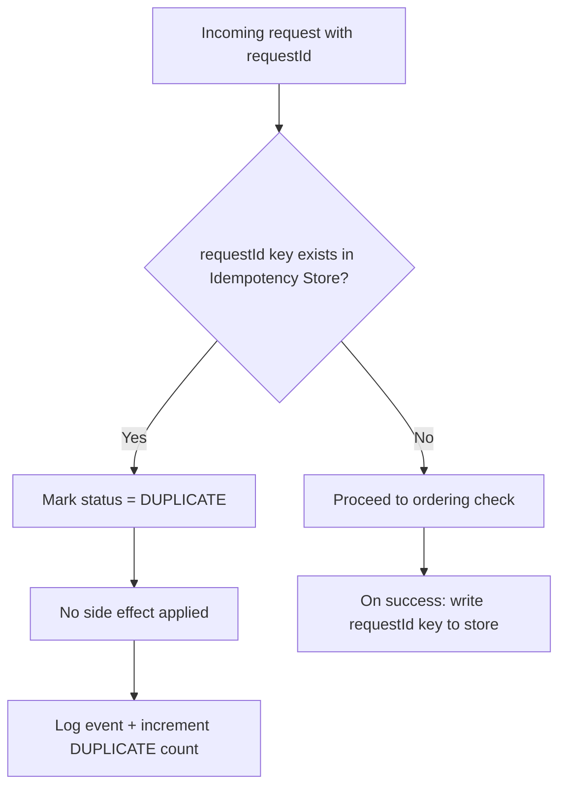
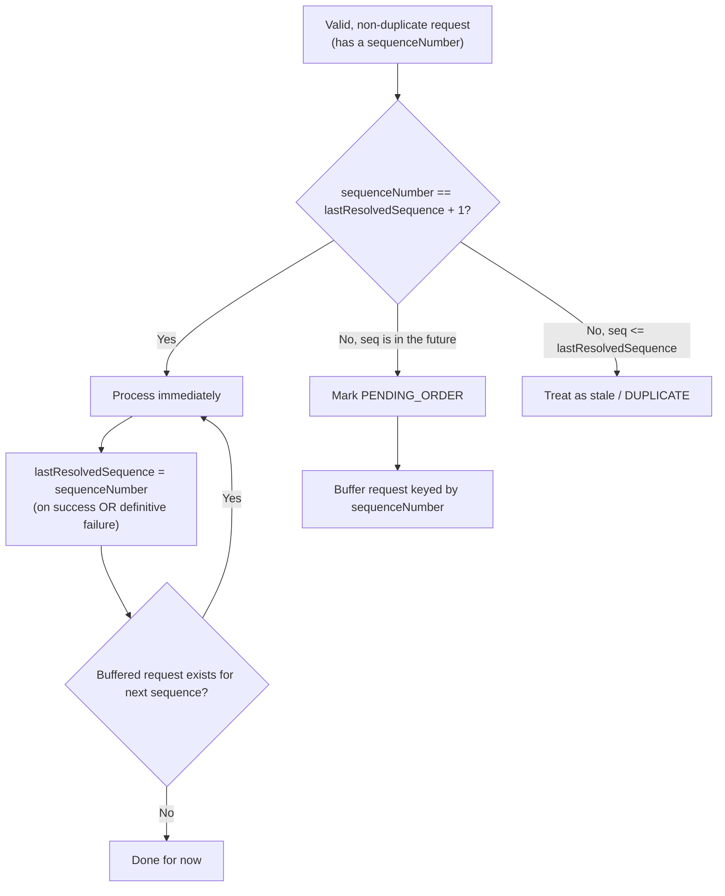
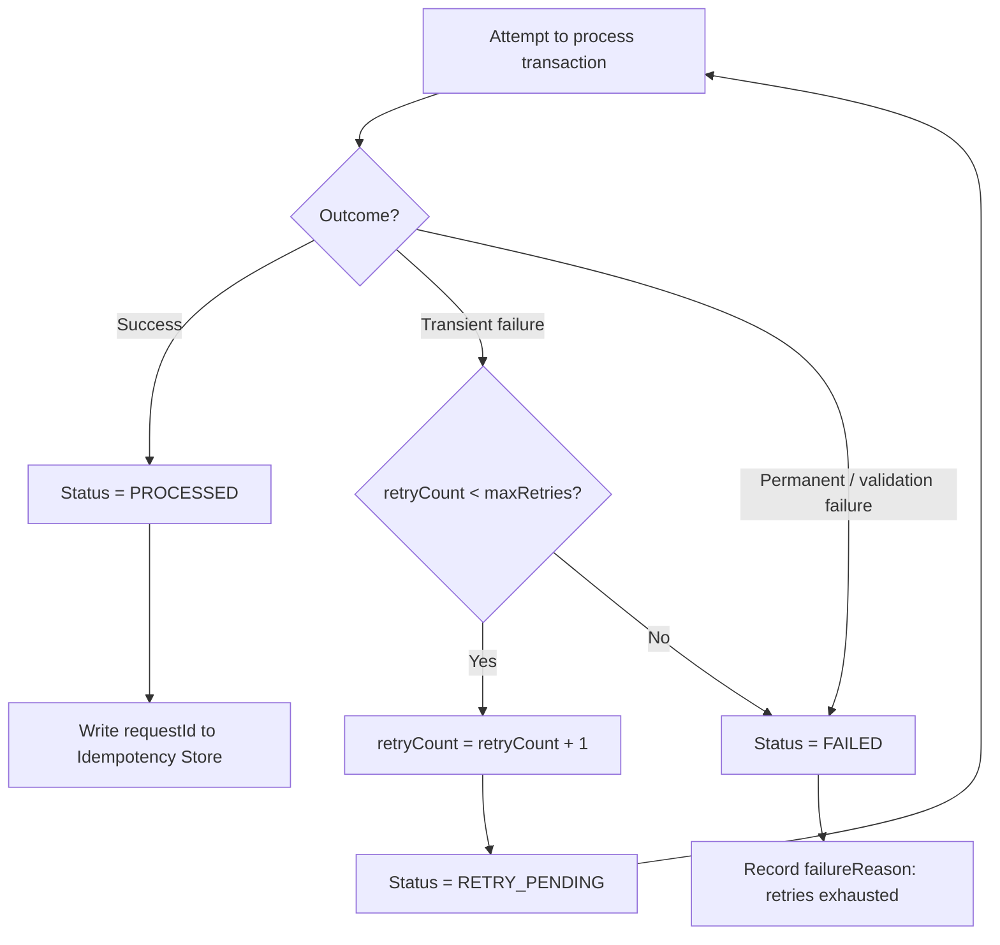
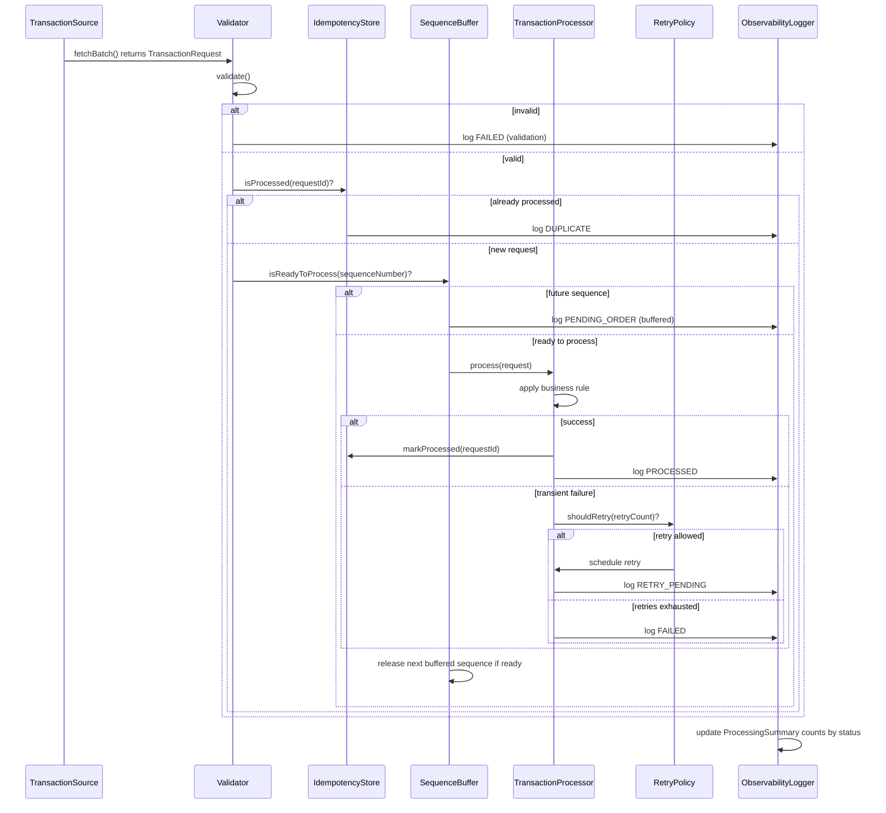

# Design Note — Idempotent Background Transaction Processing Service

FDE L2 Practical Assessment. Domain: a simplified banking transaction ledger
(CREDIT/DEBIT/REVERSAL against an account balance). Derived from §9.4
Functional Requirements, §6 Non-Functional Requirements, and §9.7 Acceptance
Criteria of the problem statement. A live, clickable version of everything
below (with bidirectional links back to the source requirement text) is in
[`docs/`](docs/index.html).

## Requirement Catalog

| ID | Category | Requirement |
|---|---|---|
| L2-FR-01 | FR | Accept transaction requests from a configurable or replaceable input source |
| L2-FR-02 | FR | Validate mandatory fields and reject malformed records |
| L2-FR-03 | FR | Maintain transaction processing state |
| L2-FR-04 | FR | Support a status lifecycle (RECEIVED, PROCESSING, PROCESSED, DUPLICATE, FAILED, RETRY_PENDING) |
| L2-FR-05 | FR | Process each unique business transaction only once |
| L2-FR-06 | FR | Detect duplicate requests even if they arrive later in the batch |
| L2-FR-07 | FR | Define and implement a strategy for out-of-order events |
| L2-FR-08 | FR | Simulate at least one retryable failure scenario |
| L2-FR-09 | FR | Retry failed transient records without creating duplicate effects |
| L2-FR-10 | FR | Separate business processing logic from input handling where practical |
| L2-FR-11 | FR | Produce a processing summary with counts by status |
| L2-FR-12 | FR | Include tests for duplicate, out-of-order, invalid, and retry scenarios |
| NFR-01 | NFR | Idempotency — duplicate requests must not cause duplicate effects |
| NFR-02 | NFR | Ordering — tolerate requests arriving in any order |
| NFR-03 | NFR | Resilience — handle transient failures with safe retries |
| NFR-04 | NFR | Data Consistency — no partially updated transaction state |
| NFR-05 | NFR | Observability — logs + operational visibility |
| NFR-06 | NFR | Security & Data Handling — validation, no secrets, no sensitive logs |
| NFR-07 | NFR | Maintainability — modular, testable, separated concerns |

## User Stories & Acceptance Criteria

### US-01 — Configurable Transaction Ingestion (Must) — traces to L2-FR-01
As an **operator**, I want the service to accept transaction requests from a
configurable, replaceable input source, so that the same core logic can
later be wired to a real queue, file, or API without touching business logic.
- **AC-01.1**: Given an in-memory list of transaction requests, when the service starts, then it loads all requests through a single `TransactionSource` interface.
- **AC-01.2**: Given the input source implementation is swapped (e.g. for a file reader), when the service runs, then no change is required in the validator, processor, or state-store classes.

### US-02 — Input Validation (Must) — traces to L2-FR-02, NFR-06
As a **system owner**, I want malformed transaction records rejected before
processing, so that bad data cannot corrupt transaction state or crash the batch.
- **AC-02.1**: Given a request missing a mandatory field, when it is ingested, then it is marked FAILED with a validation reason and excluded from business processing.
- **AC-02.2**: Given a request with a negative amount (e.g. TXN-2004, amount = -10), when it is validated, then it is rejected as FAILED with a clear reason, without halting the rest of the batch.
- **AC-02.3**: Given one invalid record inside a batch of N, when the batch runs, then the remaining N-1 valid records are still processed normally.

### US-03 — Transaction State Lifecycle (Must) — traces to L2-FR-03, L2-FR-04
As a **QA/operations reviewer**, I want every transaction to carry a
well-defined, enforced status, so that I can always tell what happened to a
given request without reading code.
- **AC-03.1**: Given a new request, when it is constructed, then its initial status is RECEIVED.
- **AC-03.2**: Given a RECEIVED request picked up for work, when processing starts, then status transitions to PROCESSING.
- **AC-03.3**: Given any transaction at any point in time, when its status is inspected, then it is exactly one of RECEIVED, PROCESSING, PENDING_ORDER, RETRY_PENDING, PROCESSED, DUPLICATE, FAILED.
- **AC-03.4**: Given an illegal transition is attempted (e.g. DUPLICATE → PROCESSING), when it is attempted, then it is rejected and logged as an invalid transition.

### US-04 — Idempotent Processing & Duplicate Detection (Must) — traces to L2-FR-05, L2-FR-06, NFR-01
As a **business owner**, I want each unique transaction processed exactly
once regardless of retries or replays, so that customers are never
double-charged or double-credited.
- **AC-04.1**: Given a requestId already marked PROCESSED, when the same requestId is submitted again, then it is marked DUPLICATE and no balance/ledger side effect occurs.
- **AC-04.2**: Given REQ-2 and REQ-2-DUP both referencing TXN-2002 (§9.8, rows 1 & 3), when REQ-2 is processed first, then REQ-2-DUP is detected as DUPLICATE even though it arrives later in the batch.
- **AC-04.3**: Given the idempotency store keyed by requestId, when the same request is submitted N times, then the final ledger effect is identical to processing it exactly once.

### US-05 — Out-of-Order Request Handling, Option A (Must) — traces to L2-FR-07, NFR-02
As **the system**, I want to process a request only after all of its prior
required sequence numbers have arrived, so that account balances are always
computed on a consistent, ordered history.
- **AC-05.1**: Given TXN-2002 (seq=2) arrives before TXN-2001 (seq=1) (§9.8, rows 1 & 2), when seq=2 is received, then it is held as PENDING_ORDER, not processed.
- **AC-05.2**: Given seq=1 later arrives and is processed, when processing completes, then the buffered seq=2 request is automatically released and processed next, in order.
- **AC-05.3**: Given a sequence number that never arrives within the batch, when end-of-batch is reached, then the missing sequence is reported in the processing summary, not silently dropped.

### US-06 — Retry-Safe Resilience (Must) — traces to L2-FR-08, L2-FR-09, NFR-03
As an **operator**, I want transient failures retried automatically without
duplicating effects, so that temporary downstream issues never cause lost or
duplicated transactions.
- **AC-06.1**: Given a transaction simulated to fail transiently (e.g. TXN-2005, §9.8 row 6), when processing fails, then status becomes RETRY_PENDING and retryCount is incremented.
- **AC-06.2**: Given a transaction retried up to the configured max retry count and still failing, when the last retry fails, then status becomes FAILED with a recorded reason, and no partial effect remains.
- **AC-06.3**: Given a transaction that succeeds on retry attempt K, when it succeeds, then it is marked PROCESSED exactly once — the idempotency store prevents any earlier partial attempt from also taking effect.

### US-07 — Data Consistency (Should) — traces to NFR-04
As a **system owner**, I want transaction processing to be atomic from the
caller's point of view, so that no transaction is ever left half-applied.
- **AC-07.1**: Given a transaction being processed, when a failure occurs mid-step, then the visible state is either fully PROCESSED or fully FAILED/RETRY_PENDING — never a mix of "balance updated but status not updated".
- **AC-07.2**: Given concurrent requests for the same accountId, when both are processed, then updates are serialized per account to avoid lost updates.

### US-08 — Observability & Processing Summary (Must) — traces to L2-FR-11, NFR-05
As an **SDET/operations reviewer**, I want structured logs and a summary
report at the end of a run, so that I can verify outcomes without manually
inspecting code.
- **AC-08.1**: Given a batch run has completed, when the summary is generated, then it reports counts by status.
- **AC-08.2**: Given any transaction event, when it occurs, then a structured log line is emitted with transactionId, requestId, status, and timestamp — no sensitive fields.

### US-09 — Security & Safe Data Handling (Should) — traces to NFR-06
As a **security-conscious engineer**, I want sensitive fields protected and
all input validated, so that the service never leaks data or accepts unsafe input.
- **AC-09.1**: Given any log statement for a transaction, when it is emitted, then it never includes full account numbers or PII beyond a masked/short accountId reference.
- **AC-09.2**: Given the service configuration, when it is reviewed, then no secrets or credentials are hardcoded in source — all are externalized.

### US-10 — Maintainable, Modular Design (Should) — traces to L2-FR-10, NFR-07
As a **future maintainer**, I want business rules separated from
input/infrastructure code, so that the service can evolve with minimal risk.
- **AC-10.1**: Given the TransactionProcessor, when it is inspected, then it has no direct dependency on how input is sourced.
- **AC-10.2**: Given the idempotency store, when it is inspected, then it sits behind an `IdempotencyStore` interface so an in-memory map can later be swapped for Redis/DB without touching business logic.

### US-11 — Automated Test Coverage (Must) — traces to L2-FR-12
As a **quality owner**, I want automated, readable tests for every critical
scenario, organized one Cucumber feature file per User Story, so that
regressions are caught immediately and the spec and the test stay in lock-step.
- **AC-11.1**: Given the §9.8 data set replayed in order, when the full Cucumber suite runs, then there is at least one passing scenario per case: duplicate, out-of-order, invalid, retry-to-success/exhaustion.
- **AC-11.2**: Given a regression introduced in the idempotency check, when tests run, then at least one test fails.

## High-Level Design (HLD-01)

## Low-Level Design (LLD-01)

## Flow Charts

### FC-01 — End-to-End Decision Flow

### FC-02 — Idempotency / Duplicate-Detection Flow

### FC-03 — Out-of-Order / Sequence Buffer Flow
One cursor for the whole batch, not per account (see DD-02) — verified against §9.8.

### FC-04 — Retry / Failure Flow

## Sequence Diagram (SEQ-01)

## Design Decisions

- **DD-01** — Stack: Java 17 + Spring Boot, `CommandLineRunner` (no web layer, no DB). Ground rules (§7) explicitly allow Java; no production DB or complex UI is mandated. A console-style batch run keeps the build boring and testable.
- **DD-02** — Out-of-order strategy: Option A, sequence-based buffering, **one cursor for the whole batch, not per account**. The §9.8 data is ordered by sequence. The cursor is batch-wide, not per `accountId` as first drafted: with a per-account cursor, `ACC-203`'s one and only transaction (sequence 5, no sequence 1-4 ever exists for that account) could never become "ready" and would never reach the retry logic — contradicting §9.8's own expected outcome for that row. Running the engine against the real data surfaced this; a single cursor, advanced on every resolved sequence number including validation failures (so one permanently failed record never blocks everything after it), reproduces all six §9.8 expected outcomes exactly. Option C (eventTime/version, "latest wins") remains the noted production-scale alternative.
- **DD-03** — Idempotency key = `requestId` (not `transactionId`). `transactionId` identifies the business transaction; `requestId`/idempotencyKey identifies the physical attempt.
- **DD-04** — Max retry count = 3, in-memory simulation. Simple, bounded, easy to assert in tests; a real deployment would externalize this and use scheduler/queue redelivery counts.
- **DD-05** — Production hardening notes (explained, not built): swap in-memory stores for Redis/DB with a unique constraint on `requestId`; swap `TransactionSource` for a real queue (Kafka/SQS) with consumer-group ordering; add per-account locking/optimistic concurrency for NFR-04; add Micrometer metrics/tracing beyond console logs; add payload fingerprinting alongside `requestId` to catch a key reused for a genuinely different transaction; be aware that true concurrent (not just sequential-retry) duplicate submissions need a DB unique constraint, not just an in-memory check-then-set, to avoid a race.
- **DD-06** — Test strategy: Cucumber BDD, one feature file per User Story, step definitions call the engine directly (no HTTP) — consistent with DD-01.

## Traceability Matrix

| Requirement | User Story | Diagrams |
|---|---|---|
| L2-FR-01 | US-01 | HLD-01, LLD-01 |
| L2-FR-02 | US-02 | HLD-01, FC-01, LLD-01 |
| L2-FR-03 | US-03 | LLD-01, FC-01 |
| L2-FR-04 | US-03 | LLD-01, FC-01 |
| L2-FR-05 | US-04 | HLD-01, FC-02, SEQ-01, LLD-01 |
| L2-FR-06 | US-04 | HLD-01, FC-02, SEQ-01, LLD-01 |
| L2-FR-07 | US-05 | HLD-01, FC-03, SEQ-01, LLD-01 |
| L2-FR-08 | US-06 | HLD-01, FC-04, SEQ-01, LLD-01 |
| L2-FR-09 | US-06 | HLD-01, FC-04, SEQ-01, LLD-01 |
| L2-FR-10 | US-10 | LLD-01 |
| L2-FR-11 | US-08 | HLD-01, FC-01 |
| L2-FR-12 | US-11 | FC-01, FC-02, FC-03, FC-04 |
| NFR-01 | US-04 | HLD-01, FC-02, SEQ-01, LLD-01 |
| NFR-02 | US-05 | HLD-01, FC-03, SEQ-01, LLD-01 |
| NFR-03 | US-06 | HLD-01, FC-04, SEQ-01, LLD-01 |
| NFR-04 | US-07 | FC-01, SEQ-01 |
| NFR-05 | US-08 | HLD-01, FC-01 |
| NFR-06 | US-02, US-09 | LLD-01 |
| NFR-07 | US-10 | LLD-01 |

## BDD Test Plan

One Cucumber `.feature` file per User Story (Scenario = Acceptance Criterion), under
`transaction-service/src/test/resources/features/`:

| User Story | Feature File |
|---|---|
| US-01 | `US-01_configurable_ingestion.feature` |
| US-02 | `US-02_input_validation.feature` |
| US-03 | `US-03_transaction_state_lifecycle.feature` |
| US-04 | `US-04_idempotent_processing.feature` |
| US-05 | `US-05_out_of_order_handling.feature` |
| US-06 | `US-06_retry_resilience.feature` |
| US-07 | `US-07_data_consistency.feature` |
| US-08 | `US-08_observability_summary.feature` |
| US-09 | `US-09_security_data_handling.feature` |
| US-10 | `US-10_maintainable_design.feature` |
| US-11 | `end_to_end_batch.feature` (single stateful scenario replaying the full §9.8 batch in order) |

## AI-Assisted Development Usage

Built with Claude Code, iteratively: User Stories/ACs were written first,
then HLD/LLD/flowcharts, then Cucumber feature files (one scenario per AC),
*then* the engine and step definitions — classic BDD/ATDD ordering, not
code-first. Three reference open-source "idempotent payment" repos were
pulled and read for comparison before committing to this design; all three
covered idempotency well but none handled out-of-order/sequence processing,
which confirmed this was the differentiating, harder half of the assessment.
Every piece of generated code was run and verified against the real §9.8
data rather than trusted by inspection — doing so surfaced 4 real defects
(see `RELEASE_NOTES.md`), including a genuine design correction (DD-02).
