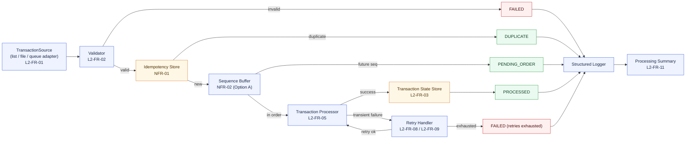
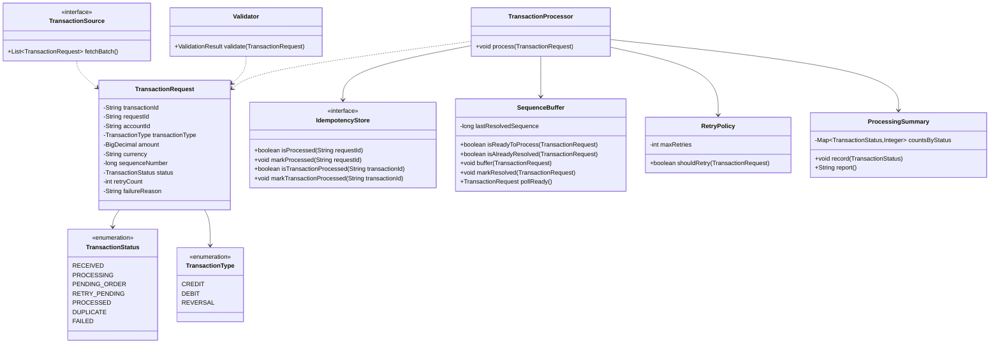
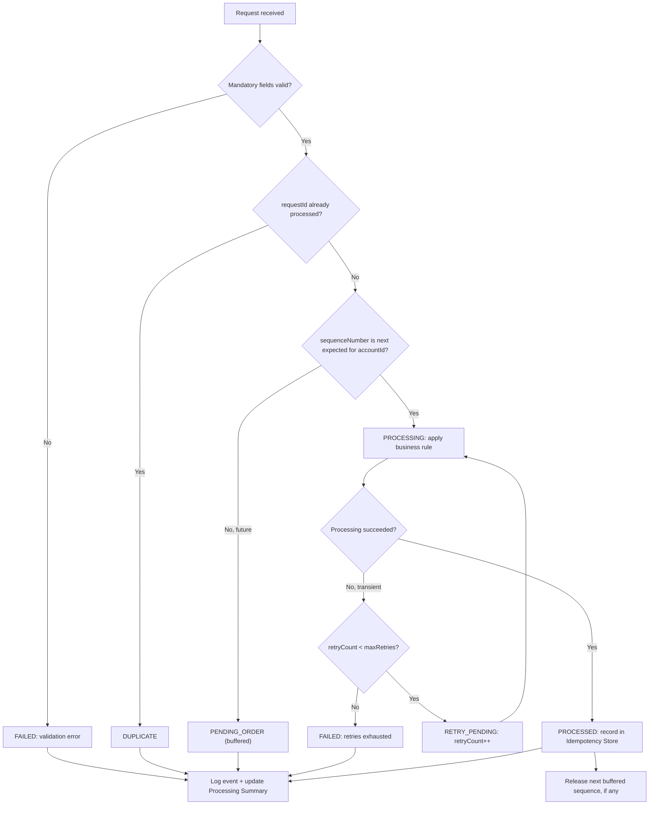
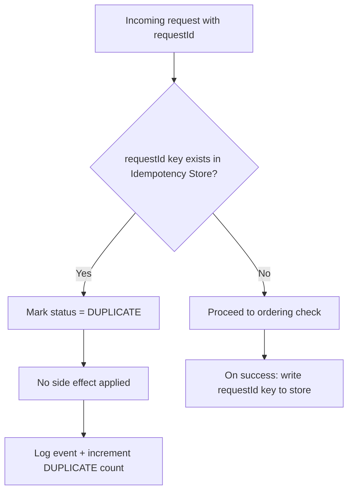
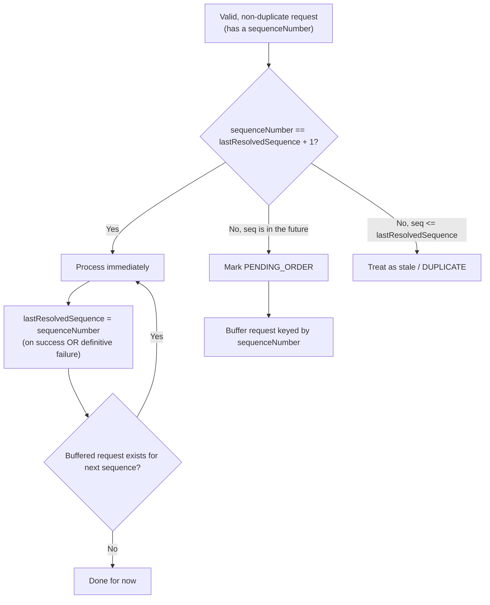
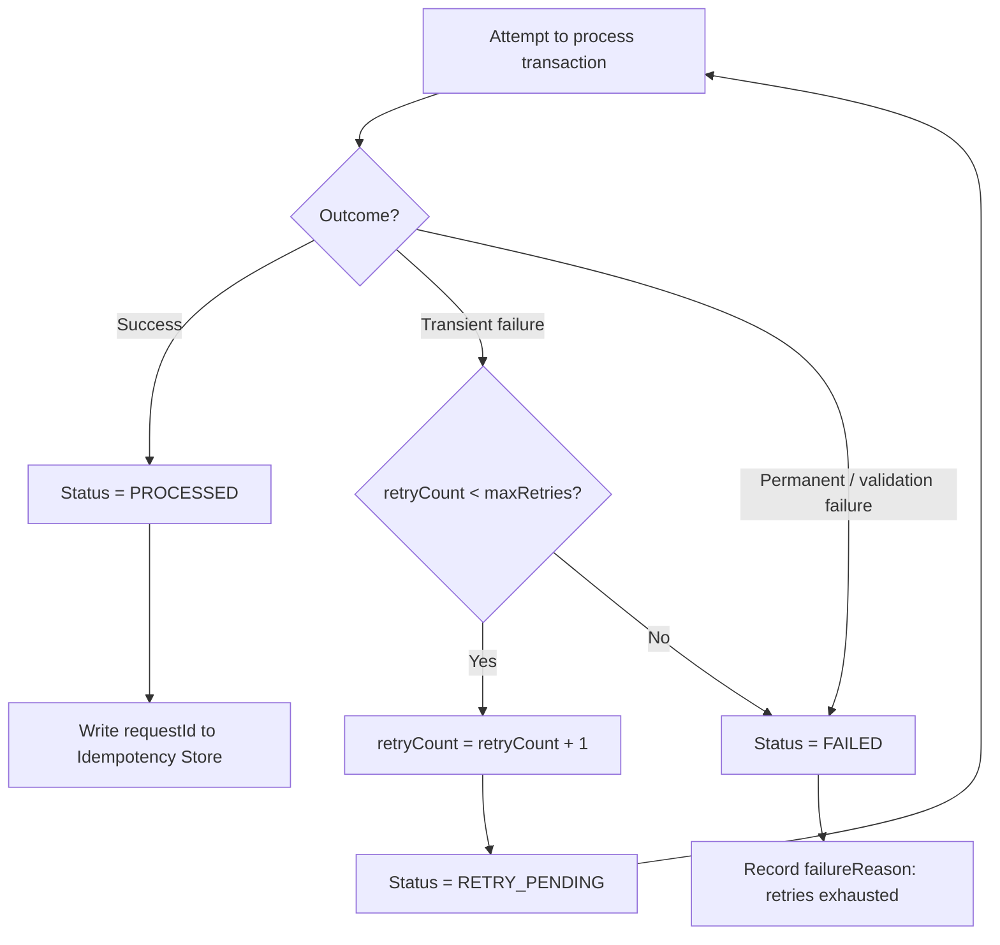
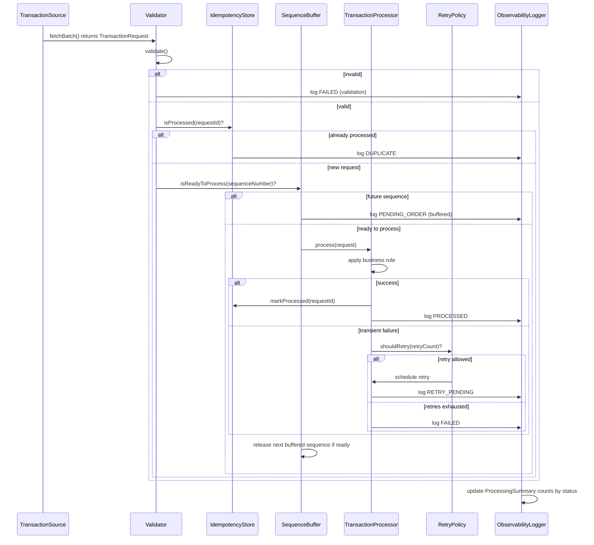

# Design Note — Idempotent Background Transaction Processing Service

FDE L2 Practical Assessment. Domain: a simplified banking transaction ledger
(CREDIT/DEBIT/REVERSAL against an account balance). Derived from §9.4
Functional Requirements, §6 Non-Functional Requirements, and §9.7 Acceptance
Criteria of the problem statement. A live, clickable version of everything
below (with bidirectional links back to the source requirement text) is in
[`docs/`](docs/index.html).

## Requirement Catalog

| ID | Category | Requirement |
|---|---|---|
| L2-FR-01 | FR | Accept transaction requests from a configurable or replaceable input source |
| L2-FR-02 | FR | Validate mandatory fields and reject malformed records |
| L2-FR-03 | FR | Maintain transaction processing state |
| L2-FR-04 | FR | Support a status lifecycle (RECEIVED, PROCESSING, PROCESSED, DUPLICATE, FAILED, RETRY_PENDING) |
| L2-FR-05 | FR | Process each unique business transaction only once |
| L2-FR-06 | FR | Detect duplicate requests even if they arrive later in the batch |
| L2-FR-07 | FR | Define and implement a strategy for out-of-order events |
| L2-FR-08 | FR | Simulate at least one retryable failure scenario |
| L2-FR-09 | FR | Retry failed transient records without creating duplicate effects |
| L2-FR-10 | FR | Separate business processing logic from input handling where practical |
| L2-FR-11 | FR | Produce a processing summary with counts by status |
| L2-FR-12 | FR | Include tests for duplicate, out-of-order, invalid, and retry scenarios |
| NFR-01 | NFR | Idempotency — duplicate requests must not cause duplicate effects |
| NFR-02 | NFR | Ordering — tolerate requests arriving in any order |
| NFR-03 | NFR | Resilience — handle transient failures with safe retries |
| NFR-04 | NFR | Data Consistency — no partially updated transaction state |
| NFR-05 | NFR | Observability — logs + operational visibility |
| NFR-06 | NFR | Security & Data Handling — validation, no secrets, no sensitive logs |
| NFR-07 | NFR | Maintainability — modular, testable, separated concerns |

## User Stories & Acceptance Criteria

### US-01 — Configurable Transaction Ingestion (Must) — traces to L2-FR-01
As an **operator**, I want the service to accept transaction requests from a
configurable, replaceable input source, so that the same core logic can
later be wired to a real queue, file, or API without touching business logic.
- **AC-01.1**: Given an in-memory list of transaction requests, when the service starts, then it loads all requests through a single `TransactionSource` interface.
- **AC-01.2**: Given the input source implementation is swapped (e.g. for a file reader), when the service runs, then no change is required in the validator, processor, or state-store classes.

### US-02 — Input Validation (Must) — traces to L2-FR-02, NFR-06
As a **system owner**, I want malformed transaction records rejected before
processing, so that bad data cannot corrupt transaction state or crash the batch.
- **AC-02.1**: Given a request missing a mandatory field, when it is ingested, then it is marked FAILED with a validation reason and excluded from business processing.
- **AC-02.2**: Given a request with a negative amount (e.g. amount = -10.50), when it is validated, then it is rejected as FAILED with a clear reason, without halting the rest of the batch.
- **AC-02.3**: Given one invalid record inside a batch of N, when the batch runs, then the remaining N-1 valid records are still processed normally.
- **AC-02.4**: Given a request with a non-positive sequence number, when it is validated, then it is rejected as FAILED with a clear reason, without halting the rest of the batch.

### US-03 — Transaction State Lifecycle (Must) — traces to L2-FR-03, L2-FR-04
As a **QA/operations reviewer**, I want every transaction to carry a
well-defined, enforced status, so that I can always tell what happened to a
given request without reading code.
- **AC-03.1**: Given a new request, when it is constructed, then its initial status is RECEIVED.
- **AC-03.2**: Given a RECEIVED request picked up for work, when processing starts, then status transitions to PROCESSING.
- **AC-03.3**: Given any transaction at any point in time, when its status is inspected, then it is exactly one of RECEIVED, PROCESSING, PENDING_ORDER, RETRY_PENDING, PROCESSED, DUPLICATE, FAILED.
- **AC-03.4**: Given an illegal transition is attempted (e.g. DUPLICATE → PROCESSING), when it is attempted, then it is rejected and logged as an invalid transition.

### US-04 — Idempotent Processing & Duplicate Detection (Must) — traces to L2-FR-05, L2-FR-06, NFR-01
As a **business owner**, I want each unique transaction processed exactly
once regardless of retries or replays, so that customers are never
double-charged or double-credited.
- **AC-04.1**: Given a requestId already marked PROCESSED, when the same requestId is submitted again, then it is marked DUPLICATE and no balance/ledger side effect occurs.
- **AC-04.2**: Given two requests with different requestIds both referencing the same business transaction (§9.8, rows 1 & 3), when the first is processed, then the second is detected as DUPLICATE even though it arrives later in the batch.
- **AC-04.3**: Given the idempotency store keyed by requestId, when the same request is submitted N times, then the final ledger effect is identical to processing it exactly once.
- **AC-04.4**: Given a request whose sequenceNumber is at or before the batch's already-resolved cursor, when it carries a brand-new requestId and transactionId, then it is still marked DUPLICATE via the sequence-staleness check (FC-03), and no ledger side effect occurs.

### US-05 — Out-of-Order Request Handling, Option A (Must) — traces to L2-FR-07, NFR-02
As **the system**, I want to process a request only after all of its prior
required sequence numbers have arrived, so that account balances are always
computed on a consistent, ordered history.
- **AC-05.1**: Given a transaction with seq=2 arrives before the transaction with seq=1 (§9.8, rows 1 & 2), when seq=2 is received, then it is held as PENDING_ORDER, not processed.
- **AC-05.2**: Given seq=1 later arrives and is processed, when processing completes, then the buffered seq=2 request is automatically released and processed next, in order.
- **AC-05.3**: Given a sequence number that never arrives within the batch, when end-of-batch is reached, then the missing sequence is reported in the processing summary, not silently dropped.

### US-06 — Retry-Safe Resilience (Must) — traces to L2-FR-08, L2-FR-09, NFR-03
As an **operator**, I want transient failures retried automatically without
duplicating effects, so that temporary downstream issues never cause lost or
duplicated transactions.
- **AC-06.1**: Given a transaction simulated to fail transiently (§9.8 row 6), when processing fails, then status becomes RETRY_PENDING and retryCount is incremented.
- **AC-06.2**: Given a transaction retried up to the configured max retry count and still failing, when the last retry fails, then status becomes FAILED with a recorded reason, and no partial effect remains.
- **AC-06.3**: Given a transaction that succeeds on retry attempt K, when it succeeds, then it is marked PROCESSED exactly once — the idempotency store prevents any earlier partial attempt from also taking effect.

### US-07 — Data Consistency (Should) — traces to NFR-04
As a **system owner**, I want transaction processing to be atomic from the
caller's point of view, so that no transaction is ever left half-applied.
- **AC-07.1**: Given a transaction being processed, when a failure occurs mid-step, then the visible state is either fully PROCESSED or fully FAILED/RETRY_PENDING — never a mix of "balance updated but status not updated".
- **AC-07.2**: Given concurrent requests for the same accountId, when both are processed, then updates are serialized per account to avoid lost updates.

### US-08 — Observability & Processing Summary (Must) — traces to L2-FR-11, NFR-05
As an **SDET/operations reviewer**, I want structured logs and a summary
report at the end of a run, so that I can verify outcomes without manually
inspecting code.
- **AC-08.1**: Given a batch run has completed, when the summary is generated, then it reports counts by status.
- **AC-08.2**: Given any transaction event, when it occurs, then a structured log line is emitted with transactionId, requestId, status, and timestamp — no sensitive fields.

**Audit note (closed by DD-07).** AC-08.2 only ever required "a structured
log line" and never specified a persisted log file or a machine-readable
report format, and `RELEASE_NOTES.md`'s Test evidence section correspondingly
only referenced the ExtentReport HTML — neither `cucumber.json` nor
log-file persistence was actually specified anywhere in this design before
now. Found by the user reviewing the HTML report and asking where the
JSON report and the log file actually were. AC-08.2's wording is unchanged;
the gap was in tooling/operational expectations around it, not in the AC
itself — see DD-07.

**Audit note (closed by DD-08, DD-09).** A second audit pass over the
DD-07 artifacts themselves (`cucumber.json`, `cucumber-tests.log`,
`transaction-service.log`) found that AC-08.1's counts-by-status summary,
although correctly asserted in-memory by tests, never actually reached
either log file (`grep -c SUMMARY` = 0 before the fix — see DD-08), and
that `cucumber.json` carried zero business-outcome content despite DD-07
adding it as a "machine-readable report" (0 embeddings across 104 steps —
see DD-09). Both ACs' wording is unchanged; these were tooling gaps
between the artifacts and what AC-08.1/AC-08.2 already required, not
defects in the passing tests themselves.

### US-09 — Security & Safe Data Handling (Should) — traces to NFR-06
As a **security-conscious engineer**, I want sensitive fields protected and
all input validated, so that the service never leaks data or accepts unsafe input.
- **AC-09.1**: Given any log statement for a transaction, when it is emitted, then it never includes full account numbers or PII beyond a masked/short accountId reference.
- **AC-09.2**: Given the service configuration, when it is reviewed, then no secrets or credentials are hardcoded in source — all are externalized.

**Audit note (closed by DD-10).** `AccountLedger`'s debug log line logged
the raw transaction `amount` and resulting `balance` unredacted. AC-09.1
names only account numbers/PII, so this was not a literal violation of
the AC as worded, but it was broader than the rest of the codebase's own
practice (`TransactionProcessor.logEvent` deliberately logs neither), so
`AccountLedger` was brought in line with it as a judgment call — see DD-10.

### US-10 — Maintainable, Modular Design (Should) — traces to L2-FR-10, NFR-07
As a **future maintainer**, I want business rules separated from
input/infrastructure code, so that the service can evolve with minimal risk.
- **AC-10.1**: Given the TransactionProcessor, when it is inspected, then it has no direct dependency on how input is sourced.
- **AC-10.2**: Given the idempotency store, when it is inspected, then it sits behind an `IdempotencyStore` interface so an in-memory map can later be swapped for Redis/DB without touching business logic.

### US-11 — Automated Test Coverage (Must) — traces to L2-FR-12
As a **quality owner**, I want automated, readable tests for every critical
scenario, organized one Cucumber feature file per User Story, so that
regressions are caught immediately and the spec and the test stay in lock-step.
- **AC-11.1**: Given the §9.8 data set replayed in order, when the full Cucumber suite runs, then there is at least one passing scenario per case: duplicate, out-of-order, invalid, retry-to-success/exhaustion.
- **AC-11.2**: Given a regression introduced in the idempotency check, when tests run, then at least one test fails.

## High-Level Design (HLD-01)

## Low-Level Design (LLD-01)

## Flow Charts

### FC-01 — End-to-End Decision Flow

### FC-02 — Idempotency / Duplicate-Detection Flow

### FC-03 — Out-of-Order / Sequence Buffer Flow
One cursor for the whole batch, not per account (see DD-02) — verified against §9.8.

### FC-04 — Retry / Failure Flow

## Sequence Diagram (SEQ-01)

## Design Decisions

- **DD-01** — Stack: Java 17 + Spring Boot, `CommandLineRunner` (no web layer, no DB). Ground rules (§7) explicitly allow Java; no production DB or complex UI is mandated. A console-style batch run keeps the build boring and testable.
- **DD-02** — Out-of-order strategy: Option A, sequence-based buffering, **one cursor for the whole batch, not per account**. The §9.8 data is ordered by sequence. The cursor is batch-wide, not per `accountId` as first drafted: with a per-account cursor, `ACC-203`'s one and only transaction (sequence 5, no sequence 1-4 ever exists for that account) could never become "ready" and would never reach the retry logic — contradicting §9.8's own expected outcome for that row. Running the engine against the real data surfaced this; a single cursor, advanced on every resolved sequence number including validation failures (so one permanently failed record never blocks everything after it), reproduces all six §9.8 expected outcomes exactly. Option C (eventTime/version, "latest wins") remains the noted production-scale alternative.
- **DD-03** — Idempotency check is **dual-key**: `requestId` (catches a literal retry of the exact same physical attempt) **and** `transactionId` (catches a different `requestId` for the same business transaction — e.g. two distinct requestIds both referencing the same underlying transactionId). The original design checked only `requestId`, relying on the sequence-staleness check (FC-03) to incidentally catch that second requestId. That's fragile: a duplicate reusing a *fresh, never-before-seen* sequence number would have slipped through undetected. Caught during cross-checking this design against an independent AI's analysis of the same assessment, which argued correctly that `transactionId` is the more direct, defensible dedup key for that exact test case. Fixed by adding `isTransactionProcessed`/`markTransactionProcessed` to `IdempotencyStore`, checked immediately after the `requestId` check.
- **DD-04** — Max retry count = 3, in-memory simulation. Simple, bounded, easy to assert in tests; a real deployment would externalize this and use scheduler/queue redelivery counts.
- **DD-05** — Production hardening notes (explained, not built): swap in-memory stores for Redis/DB with a unique constraint on `requestId`; swap `TransactionSource` for a real queue (Kafka/SQS) with consumer-group ordering; add per-account locking/optimistic concurrency for NFR-04; add Micrometer metrics/tracing beyond console logs; add payload fingerprinting alongside `requestId` to catch a key reused for a genuinely different transaction; be aware that true concurrent (not just sequential-retry) duplicate submissions need a DB unique constraint, not just an in-memory check-then-set, to avoid a race.
- **DD-06** — Test strategy: Cucumber BDD, one feature file per User Story, step definitions call the engine directly (no HTTP) — consistent with DD-01.
- **DD-07** — Test/run observability artifacts: add `target/cucumber-reports/cucumber.json` (machine-readable Cucumber JSON, same plugin list as the ExtentReport HTML) and persisted log files — `target/logs/cucumber-tests.log` via `src/test/resources/logback-test.xml` for `mvn test`, `target/logs/transaction-service.log` via `src/main/resources/logback-spring.xml` for `mvn spring-boot:run`. Originally, AC-08.2's structured log line only went to the console, and `RunCucumberTest`'s plugin list only produced the human-facing ExtentReport HTML; neither a machine-readable report nor a persisted log file existed as a discoverable artifact, even though AC-08.2 itself passed. Found by the user reviewing the ExtentReport HTML and asking where the JSON report and the log file were — a real gap between the design (AC-08.2 only ever said "a structured log line") and operational expectations (a reviewer also wants a persisted, machine-readable run record), not a defect in passing tests. Fixed by adding `json:target/cucumber-reports/cucumber.json` alongside the existing plugins in `RunCucumberTest`, and adding the two Logback config files above. AC-08.2's wording is left as-is; this closes the tooling gap around it rather than retroactively rewriting the AC.
- **DD-08** — `ProcessingSummary` now logs itself (`log.info(summary.report())` inside `ProcessingSummary.of(...)`), rather than only existing in memory. AC-08.1/L2-FR-11 require the summary to report counts by status, and tests did assert this correctly, but the summary never actually reached either of the DD-07 log files — `grep -c SUMMARY` was 0 in both `cucumber-tests.log` and `transaction-service.log` before this fix. Root cause: `ProcessingSummary.report()` and `TransactionServiceApplication`'s final block both printed via `System.out.println`, bypassing SLF4J entirely, so the Logback config added in DD-07 never saw it. Found by the user comparing the DD-07 artifacts (`cucumber.json`, `cucumber-tests.log`) against this design and the original assessment's own ask for a summary — a second audit pass on the same artifacts DD-07's tooling produced. Fixed at a single change point (`ProcessingSummary.of(...)`) rather than every call site, in `transaction-service/src/main/java/com/mphasis/assessment/txservice/service/ProcessingSummary.java`. Verified: `SUMMARY: ...` now appears in both log files on real `mvn test` and `mvn spring-boot:run` runs; all 27 scenarios still pass.
- **DD-09** — `Hooks.attachStepSnapshot` now also calls `scenario.attach(html.getBytes(StandardCharsets.UTF_8), "text/html", "Step Snapshot")`, in addition to its existing `ExtentCucumberAdapter.addTestStepLog(html)` call. The `cucumber.json` DD-07 added carried zero business-outcome content — 0 "embeddings" across all 104 steps — because `addTestStepLog` feeds only the Extent HTML report and is adapter-internal, invisible to Cucumber's own JSON formatter. Found the same way as DD-08: the user auditing `cucumber.json` against the design's own claim that it is a "machine-readable report" of outcomes. Fixed in `transaction-service/src/test/java/com/mphasis/assessment/txservice/steps/Hooks.java`; Cucumber's built-in JSON formatter now records the attachment as a base64 "embeddings" entry per step, independent of the Extent adapter. Verified: decoded a real embedding from the generated `cucumber.json` and confirmed it is the actual HTML snapshot (masked accountId, status, etc.) — 82 embeddings total across the run; all 27 scenarios still pass.
- **DD-10** — `AccountLedger`'s debug log line no longer prints raw transaction `amount` or resulting `balance`; it now logs only `accountId` (masked) and transaction `type`. Previously it logged e.g. `ledger accountId=***201 CREDIT 100 -> balance 100 (was 0)`. This is a judgment call, not a defect against AC-08.2's literal wording: AC-08.2 names only `accountId` as the sensitive field to withhold, and the amount/balance line technically satisfied it. But the original assessment's §6.6 ("do not log sensitive customer data unnecessarily") is broader than AC-08.2's wording, and no other class in the codebase logs amount/balance — `TransactionProcessor.logEvent` deliberately never does. Found during the same artifact audit as DD-08/DD-09. Fixed in `transaction-service/src/main/java/com/mphasis/assessment/txservice/store/AccountLedger.java` for consistency with the rest of the codebase's existing practice, not because AC-08.2 strictly required it. Verified: all 27 scenarios still pass.
- **DD-11** — Manual code-level test-coverage gap review (beyond AC-tag matching). Every previous coverage audit in this design checked that each AC had *a* scenario tagged against it; this follow-up instead read the actual engine code (`Validator`, `SequenceBuffer`, `IdempotencyStore`/`TransactionProcessor`, `RetryPolicy`, `AccountLedger`) line by line against every AC's branches and found 9 real gaps. Six were fixed directly in the test suite: (1) added **AC-02.4** (non-positive `sequenceNumber` rejected — a `Validator` branch with zero prior coverage), (2) widened **AC-02.1** from one Scenario to a Scenario Outline with 5 Examples, one per previously-untested mandatory-field branch (accountId, transactionId, requestId, currency, transactionType), (3) widened **AC-02.2** from one Scenario to a Scenario Outline with 2 Examples (negative amount, plus the zero-amount boundary case), (4) added **AC-04.4** (sequence-staleness dedup — a third, distinct duplicate-detection path in `SequenceBuffer.isAlreadyResolved()`/`TransactionProcessor`, independent of the requestId/transactionId checks behind AC-04.1/AC-04.3 and AC-04.2, that had zero scenarios reaching it before this), (5) reinforced **AC-05.1/AC-05.2** with a second "cascade-release" scenario proving the buffered-release loop chains 2+ hops deep, not just the one hop the original scenario exercised, (6) reinforced **AC-06.3** with a second scenario pinning the exact max-retry-boundary success case (succeeds on the 4th attempt, same retry count as the exhaustion path, but PROCESSED instead of FAILED). Two more were test-implementation defects with no AC-wording change: **AC-03.3**'s assertion (`EnumSet.allOf(TransactionStatus.class).contains(status)`) was vacuous and could never fail, replaced with a real "exactly these 7 statuses" invariant; **AC-09.2**'s "all are externalized" step was a bare `assertTrue(true)`, replaced with a real scan of `src/main/resources/**` for secret-looking keys bound to literal values. The remaining 2 gaps were reviewed with the user and explicitly left open rather than fixed: **`TransactionType.REVERSAL`'s DEBIT-identical semantics** and **the absence of an overdraft/insufficient-funds rule** — both recorded as new bullets in "Known Gaps" below, not silently dropped. Verified-by note: every fix above was traced by hand against the real `Validator`/`SequenceBuffer`/`RetryPolicy`/`IdempotencyStore` logic and the new/widened feature files; this has **not** yet been confirmed by an actual `mvn test` run — the user will run it and report back.

## Traceability Matrix

| Requirement | User Story | Diagrams |
|---|---|---|
| L2-FR-01 | US-01 | HLD-01, LLD-01 |
| L2-FR-02 | US-02 | HLD-01, FC-01, LLD-01 |
| L2-FR-03 | US-03 | LLD-01, FC-01 |
| L2-FR-04 | US-03 | LLD-01, FC-01 |
| L2-FR-05 | US-04 | HLD-01, FC-02, SEQ-01, LLD-01 |
| L2-FR-06 | US-04 | HLD-01, FC-02, SEQ-01, LLD-01 |
| L2-FR-07 | US-05 | HLD-01, FC-03, SEQ-01, LLD-01 |
| L2-FR-08 | US-06 | HLD-01, FC-04, SEQ-01, LLD-01 |
| L2-FR-09 | US-06 | HLD-01, FC-04, SEQ-01, LLD-01 |
| L2-FR-10 | US-10 | LLD-01 |
| L2-FR-11 | US-08 | HLD-01, FC-01 |
| L2-FR-12 | US-11 | FC-01, FC-02, FC-03, FC-04 |
| NFR-01 | US-04 | HLD-01, FC-02, SEQ-01, LLD-01 |
| NFR-02 | US-05 | HLD-01, FC-03, SEQ-01, LLD-01 |
| NFR-03 | US-06 | HLD-01, FC-04, SEQ-01, LLD-01 |
| NFR-04 | US-07 | FC-01, SEQ-01 |
| NFR-05 | US-08 | HLD-01, FC-01 |
| NFR-06 | US-02, US-09 | LLD-01 |
| NFR-07 | US-10 | LLD-01 |

### Requirement → AC → Test Case Matrix (audited against real `.feature` files)

Rooted down to the actual Cucumber scenario per AC, audited directly against
every file under `transaction-service/src/test/resources/features/` (not
reconstructed from memory). One row per AC.

| FR/NFR | US | AC | Behavior | Type | Feature File | Scenario | Status |
|---|---|---|---|---|---|---|---|
| L2-FR-01 | US-01 | AC-01.1 | Load requests via `TransactionSource` | Positive | US-01_configurable_ingestion.feature | "Requests load through a single input source abstraction" | Covered |
| L2-FR-01 | US-01 | AC-01.2 | Swap source implementation -> no business-logic change | Positive | US-01_configurable_ingestion.feature | "Swapping the input source does not affect business logic" | Covered |
| L2-FR-02, NFR-06 | US-02 | AC-02.1 | Missing mandatory field -> FAILED | Negative | US-02_input_validation.feature | "Missing mandatory field is rejected" — now a Scenario Outline with 5 Examples (one per Validator branch): accountId, transactionId, requestId, currency, transactionType | Covered |
| L2-FR-02, NFR-06 | US-02 | AC-02.2 | Negative amount -> FAILED, clear reason | Negative | US-02_input_validation.feature | "Invalid amount is rejected with a clear reason" — now a Scenario Outline with 2 Examples: negative amount, zero amount (boundary) | Covered |
| L2-FR-02 | US-02 | AC-02.3 | 1 invalid record in batch of N -> N-1 still processed | Edge | US-02_input_validation.feature | "One invalid record does not stop the batch" | Covered |
| L2-FR-02 | US-02 | AC-02.4 | Non-positive sequenceNumber rejected | Negative | US-02_input_validation.feature | "Non-positive sequence number is rejected" | Covered |
| L2-FR-03 | US-03 | AC-03.1 | New request -> RECEIVED | Positive | US-03_transaction_state_lifecycle.feature | "New request starts as RECEIVED" | Covered |
| L2-FR-03 | US-03 | AC-03.2 | RECEIVED -> PROCESSING | Positive | US-03_transaction_state_lifecycle.feature | "Processing transitions status to PROCESSING" | Covered |
| L2-FR-04 | US-03 | AC-03.3 | Status always in defined enum | Edge (invariant) | US-03_transaction_state_lifecycle.feature | "Status is always one of the defined lifecycle values" — test implementation fixed: old assertion (`EnumSet.allOf(TransactionStatus.class).contains(status)`) was vacuous (any enum value is necessarily a member of its own type, so it could never fail); replaced with a real invariant asserting the enum's full value set equals exactly the 7 named statuses before checking membership. AC wording unchanged. | Covered |
| L2-FR-04 | US-03 | AC-03.4 | Illegal transition (DUPLICATE->PROCESSING) rejected | Negative | US-03_transaction_state_lifecycle.feature | "Illegal transitions are rejected" | Covered |
| L2-FR-05, NFR-01 | US-04 | AC-04.1 | Already-PROCESSED requestId -> DUPLICATE, no side effect | Negative | US-04_idempotent_processing.feature | "Already-processed requestId is marked DUPLICATE" | Covered |
| L2-FR-06, NFR-01 | US-04 | AC-04.2 | Late-arriving duplicate (same transaction, new requestId) detected | Edge | US-04_idempotent_processing.feature | "A duplicate arriving later in the batch is still detected" | Covered |
| L2-FR-05, NFR-01 | US-04 | AC-04.3 | N resubmits -> exactly-once ledger effect | Edge | US-04_idempotent_processing.feature | "Repeated submissions yield exactly one effect" | Covered |
| L2-FR-06, NFR-01, NFR-02 | US-04 | AC-04.4 | Stale sequence -> DUPLICATE even with brand-new requestId/transactionId (FC-03 staleness path) | Edge | US-04_idempotent_processing.feature | "A stale sequence number is treated as a duplicate even with brand-new identifiers" | Covered |
| L2-FR-07, NFR-02 | US-05 | AC-05.1 | Future sequence -> PENDING_ORDER, not processed | Edge | US-05_out_of_order_handling.feature | "A future sequence is buffered, then released once its predecessor arrives" (shared scenario, tagged @AC-05.1 @AC-05.2); also now reinforced by a second scenario, "Multiple buffered sequences cascade-release once their predecessor arrives" (same tags), proving the release loop chains 2+ hops deep, not just one | Covered |
| L2-FR-07, NFR-02 | US-05 | AC-05.2 | Predecessor arrives -> buffered seq auto-released in order | Positive | US-05_out_of_order_handling.feature | same scenario as AC-05.1 (combined, not split — see DD-02); also now reinforced by the "Multiple buffered sequences cascade-release..." scenario above | Covered (shared scenario) |
| L2-FR-07, NFR-02 | US-05 | AC-05.3 | Sequence never arrives -> reported in summary, not dropped | Edge/Negative | US-05_out_of_order_handling.feature | "A missing sequence is reported, not dropped" | Covered |
| L2-FR-08, NFR-03 | US-06 | AC-06.1 | Transient failure -> RETRY_PENDING, retryCount++ | Negative | US-06_retry_resilience.feature | "Transient failure moves a transaction to RETRY_PENDING" | Covered |
| L2-FR-09, NFR-03 | US-06 | AC-06.2 | Max retries exhausted -> FAILED, no partial effect | Negative | US-06_retry_resilience.feature | "Exhausted retries result in FAILED with no partial effect" | Covered |
| L2-FR-09, NFR-03 | US-06 | AC-06.3 | Success on retry K -> PROCESSED exactly once | Edge | US-06_retry_resilience.feature | "Eventual success after retry is recorded exactly once"; now also reinforced by a second scenario, "Eventual success exactly on the last allowed retry attempt", covering the exact max-retry-boundary success case (succeeds on the 4th attempt / retryCount reaches 3, same count as the exhaustion case, but PROCESSED instead of FAILED) | Covered |
| NFR-04 | US-07 | AC-07.1 | Mid-step failure -> never a mixed state | Edge | US-07_data_consistency.feature | "A failure mid-step never leaves a mixed state" | Covered |
| NFR-04 | US-07 | AC-07.2 | Concurrent same-account requests serialized | Edge | US-07_data_consistency.feature | "Concurrent requests for the same account are serialized" | Covered |
| L2-FR-11, NFR-05 | US-08 | AC-08.1 | Summary reports counts by status | Positive | US-08_observability_summary.feature | "Summary reports counts by status" | Covered |
| NFR-05, NFR-06 | US-08 | AC-08.2 | Structured log line, no sensitive fields | Positive | US-08_observability_summary.feature | "Every event is logged without sensitive fields" | Covered |
| NFR-06 | US-09 | AC-09.1 | No full account numbers/PII in logs | Negative (security) | US-09_security_data_handling.feature | "Logs never contain full account numbers or PII" | Covered |
| NFR-06 | US-09 | AC-09.2 | No hardcoded secrets/credentials | Positive (security) | US-09_security_data_handling.feature | "No hardcoded secrets in configuration" — test implementation fixed: the old "all are externalized" step was `assertTrue(true)` and asserted nothing; replaced with a real scan of `src/main/resources/**` for a secret-looking key (password/secret/api_key/access_token) bound to a literal value instead of a `${...}` placeholder. AC wording unchanged. | Covered |
| L2-FR-10, NFR-07 | US-10 | AC-10.1 | Processor has no dependency on input source | Positive (design) | US-10_maintainable_design.feature | "Processor has no dependency on input source details" | Covered |
| L2-FR-10, NFR-07 | US-10 | AC-10.2 | IdempotencyStore behind swappable interface | Positive (design) | US-10_maintainable_design.feature | "Idempotency store is swappable behind an interface" | Covered |
| L2-FR-12 | US-11 | AC-11.1 | Full section-9.8 batch -> documented final statuses | Positive (integration) | end_to_end_batch.feature | "The full section 9.8 sample batch processes to the documented outcomes" | Covered |
| L2-FR-12 | US-11 | AC-11.1 | Processing summary reconciles with batch outcome | Positive (integration) | end_to_end_batch.feature | "The processing summary reconciles with the batch outcome" | Covered |
| L2-FR-12 | US-11 | AC-11.2 | Regression introduced in the idempotency check -> at least one test fails | — | none | **No scenario exists** | **GAP — open, not yet automated** |

**Coverage summary (audited counts):**

- Total ACs defined: **30** (was 28; +AC-02.4, +AC-04.4). Total Gherkin
  Scenario/Scenario Outline *definitions*: **31** (re-counted directly
  against every `.feature` file with `grep -c "^\s*Scenario" *.feature`,
  not reconstructed from memory). Total *executed* scenario instances once
  Examples are expanded: **36** (US-02's two widened Scenario Outlines —
  AC-02.1 at 5 Examples, AC-02.2 at 2 Examples — expand to 9 executed
  instances alone).
- By type (counted per AC, not per executed instance): Positive **12**,
  Negative **8**, Edge **10**. (US-05's AC-05.1/AC-05.2 share a single
  scenario definition, tagged with both ACs, by deliberate design choice —
  the single-cursor model of DD-02 — not an oversight or an unsplit
  duplicate; a second, cascade-release scenario now also covers both.)
- Coverage: **29/30 ACs covered (96.7%)**. The sole remaining gap is still
  **AC-11.2** (see "Known Gaps" below).

| US | ACs | Scenarios | Positive | Negative | Edge | Coverage |
|---|---|---|---|---|---|---|
| US-01 | 2 | 2 | 2 | 0 | 0 | 2/2 |
| US-02 | 4 | 4 defs / 9 executed | 0 | 3 | 1 | 4/4 |
| US-03 | 4 | 4 | 2 | 1 | 1 | 4/4 |
| US-04 | 4 | 4 | 0 | 1 | 3 | 4/4 |
| US-05 | 3 | 3 defs (one pair shared across AC-05.1/AC-05.2, now reinforced by a second cascade-release scenario) | 1 | 0 | 2 | 3/3 |
| US-06 | 3 | 4 (AC-06.3 now has 2 scenarios) | 0 | 2 | 1 | 3/3 |
| US-07 | 2 | 2 | 0 | 0 | 2 | 2/2 |
| US-08 | 2 | 2 | 2 | 0 | 0 | 2/2 |
| US-09 | 2 | 2 | 1 | 1 | 0 | 2/2 |
| US-10 | 2 | 2 | 2 | 0 | 0 | 2/2 |
| US-11 | 2 | 2 | 2 | 0 | 0 | 1/2 (AC-11.2 gap) |

## BDD Test Plan

One Cucumber `.feature` file per User Story (Scenario = Acceptance Criterion), under
`transaction-service/src/test/resources/features/`:

| User Story | Feature File |
|---|---|
| US-01 | `US-01_configurable_ingestion.feature` |
| US-02 | `US-02_input_validation.feature` |
| US-03 | `US-03_transaction_state_lifecycle.feature` |
| US-04 | `US-04_idempotent_processing.feature` |
| US-05 | `US-05_out_of_order_handling.feature` |
| US-06 | `US-06_retry_resilience.feature` |
| US-07 | `US-07_data_consistency.feature` |
| US-08 | `US-08_observability_summary.feature` |
| US-09 | `US-09_security_data_handling.feature` |
| US-10 | `US-10_maintainable_design.feature` |
| US-11 | `end_to_end_batch.feature` (single stateful scenario replaying the full §9.8 batch in order) — AC-11.2 has no scenario; see "Known Gaps" below |

Evidence produced per run (see DD-07): the human-facing
`docs/test-report/ExtentReport.html`, the machine-readable
`target/cucumber-reports/cucumber.json`, and persisted log files
(`target/logs/cucumber-tests.log` for `mvn test`,
`target/logs/transaction-service.log` for `mvn spring-boot:run`).

## Known Gaps (Production Hardening, Extended)

Surfaced by cross-checking this design against an independent AI session's
analysis of the same assessment (see "AI-Assisted Development Usage" below).
Not fixed — named explicitly, per §9.7's "candidate can identify trade-offs
and next steps for production hardening."

- **Ordering-scope ambiguity (validates DD-02).** The spec never states
  whether `sequenceNumber` is scoped per-account or global. We discovered
  this empirically (DD-02): a per-account cursor stranded `ACC-203`'s only
  transaction. The independent cross-check flagged the identical ambiguity
  from reading the spec alone, arriving at the same unresolved question from
  a different direction. We chose global and defended it against the real
  data; a production system should pin this contract explicitly and test it
  with cross-account interleaving.
- **Stuck-pending TTL is undefined.** A sequence gap that never fills (AC-05.3)
  leaves a request in `PENDING_ORDER` forever, with no timeout or alert. The
  processing summary surfaces it as a count, but nothing pages anyone.
- **Concurrent-duplicate testing is narrower than it sounds.** US-07's
  concurrency test proves the *ledger* serializes per-account updates
  correctly; it does not prove the *idempotency check itself* is race-free
  under two truly simultaneous first-attempts for the same key (a
  check-then-set, not an atomic claim). Safe today only because the engine
  is single-threaded; a real concurrent system needs an atomic
  claim (e.g. `INSERT ... ON CONFLICT`) at the store layer, not a
  check-then-set in application code.
- **Permutation/invariant testing would be a stronger oracle than fixed
  expected-values.** Our tests assert specific outcomes for the given §9.8
  order. A stronger test would shuffle the batch and assert the *final
  ledger state* is invariant regardless of arrival order — property-based,
  not example-based.
- **Idempotency key retention has no TTL.** Both `processedRequestIds` and
  `processedTransactionIds` grow forever in memory. Production needs a
  retention window (e.g. ≥ the longest client retry window) and a backing
  store, not an unbounded in-memory set.
- **AC-11.2 (mutation-style regression test) is not automated — open,
  named gap.** AC-11.2 asks that a regression introduced in the idempotency
  check cause at least one test to fail. Surfaced by the traceability audit
  behind the new "Requirement → AC → Test Case Matrix" above: all other 27
  ACs trace to a real, currently-passing Cucumber scenario; AC-11.2 traces
  to none. The reason it's harder than the other 27: every existing
  scenario is written to pass against the *correct* implementation, but
  AC-11.2 is really asking us to demonstrate the suite's mutation-catching
  power — i.e. that a *broken* idempotency check makes some scenario fail —
  which isn't a normal always-green Cucumber scenario at all; it needs
  either a mutation-testing tool (e.g. PIT) run as a separate step, or a
  second, deliberately-broken build variant asserted against, neither of
  which fits this repo's one-feature-file-per-AC pattern. Reviewed with the
  user, who chose to leave this as a named, undemonstrated gap for now
  rather than force-fit an automated test — not fixed, not silently
  dropped, consistent with how the other items in this section are
  recorded.
- **`TransactionType.REVERSAL` semantics are DEBIT-identical — open, named
  gap (see DD-11).** `AccountLedger.apply()` implements `REVERSAL`
  identically to `DEBIT` (always subtracts). That is only correct for
  reversing a `CREDIT`; reversing a `DEBIT` would double-subtract instead
  of crediting the amount back. No AC or scenario anywhere in the suite
  exercises `REVERSAL` at all, so this has never been caught by a test.
  Found during the DD-11 manual code-level review and raised with the
  user, who explicitly chose to leave it untouched for now rather than
  fix the logic or add a test that pins the current (incorrect-for-one
  direction) behavior.
- **No insufficient-funds/overdraft rule — open, named gap (see DD-11).**
  `DEBIT` and `REVERSAL` subtract from `AccountLedger` unconditionally;
  there is no check anywhere that prevents a balance from going negative.
  No AC specifies a minimum-balance or overdraft rule. Found during the
  same DD-11 review and raised with the user, who explicitly chose to
  leave it untouched for now.

## AI-Assisted Development Usage

Built with Claude Code, iteratively: User Stories/ACs were written first,
then HLD/LLD/flowcharts, then Cucumber feature files (one scenario per AC),
*then* the engine and step definitions — classic BDD/ATDD ordering, not
code-first. Three reference open-source "idempotent payment" repos were
pulled and read for comparison before committing to this design; all three
covered idempotency well but none handled out-of-order/sequence processing,
which confirmed this was the differentiating, harder half of the assessment.
Every piece of generated code was run and verified against the real §9.8
data rather than trusted by inspection — doing so surfaced 4 real defects
(see `RELEASE_NOTES.md`), including a genuine design correction (DD-02).

A second, independent AI session's own analysis of this same assessment was
also deliberately cross-checked against this design (not used to generate
code, used as a second opinion). It agreed on the domain, the three failure
modes, and Option A ordering. It disagreed on the dedup key — arguing
`transactionId`, where this design had used `requestId` alone — and was
right: `requestId`-only dedup relied on an incidental side effect (sequence
staleness) to catch a duplicate requestId referencing the same transaction,
which would have missed a duplicate reusing a fresh sequence number. Adopted
as DD-03's dual-key fix. Its other gap
analysis (stuck-pending TTL, atomic-claim concurrency, permutation testing,
key retention) was judged correct but out of scope to fix in the time
available, and is recorded above instead of silently dropped.

**Agent/skill/RAG layer (meta, not part of the delivered service).** The
assessment document itself never asks for an agentic architecture — it
only asks that AI tools be used to build the service and that the
resulting code be explained and validated (confirmed by re-reading the
full extracted problem statement for any mention of "agent": none found).
What's described here formalizes the *build process* itself, on top of
Claude Code, so later changes stay grounded in this document instead of
drifting the way earlier design sessions did (e.g. the console-vs-API
reversal). It is not part of `transaction-service`'s runtime.
- **RAG** — `scripts/design_lookup.py` does exact-ID retrieval (not
  embeddings) over `DESIGN.md`/`RELEASE_NOTES.md`, since every requirement,
  decision, and diagram here already carries a stable ID (`US-xx`,
  `AC-xx.y`, `L2-FR-xx`, `NFR-xx`, `DD-xx`, `HLD-01`, `LLD-01`, `FC-0x`,
  `SEQ-01`). Grep-by-structure is more reliable than semantic search for a
  document this size and this structured.
- **Agents** (`.claude/agents/`) — `design-architect` (owns `DESIGN.md`
  only), `feature-builder` (implements one User Story's code + Cucumber
  tests, grounded via the lookup script), `test-verifier` (read-only,
  cross-checks the traceability matrix against real `mvn test` output in
  both directions), `release-manager` (compiles `RELEASE_NOTES.md`/README
  evidence and handles the branch/tag flow).
- **Skills** (`.claude/skills/`) — `/iterate-feature <US-id>`,
  `/update-design`, `/trace-check`, `/release`, each sequencing the agents
  above for one step of the Design → Setup → 9 iterations → Release
  workflow already used to build this repo.
